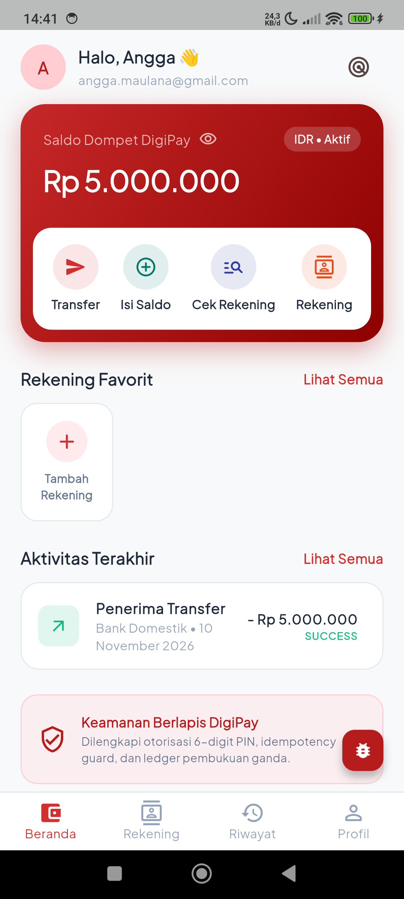
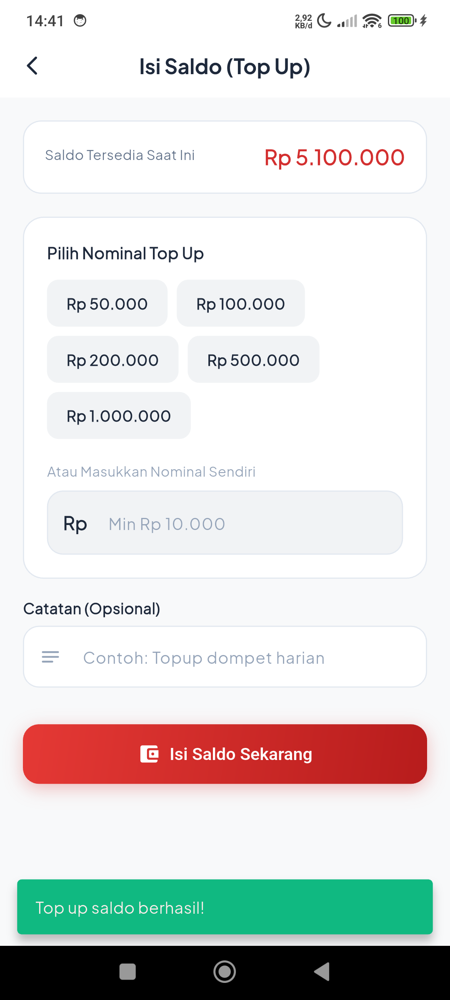
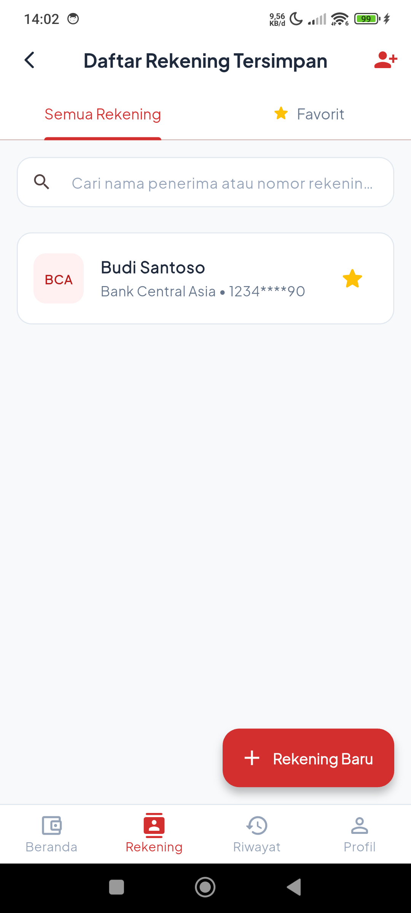
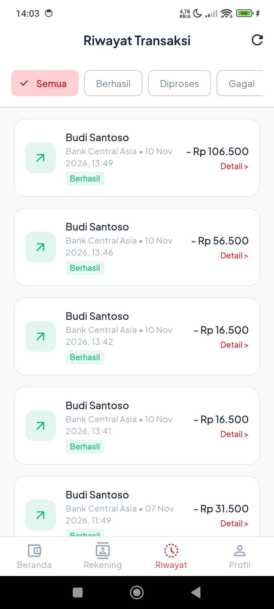
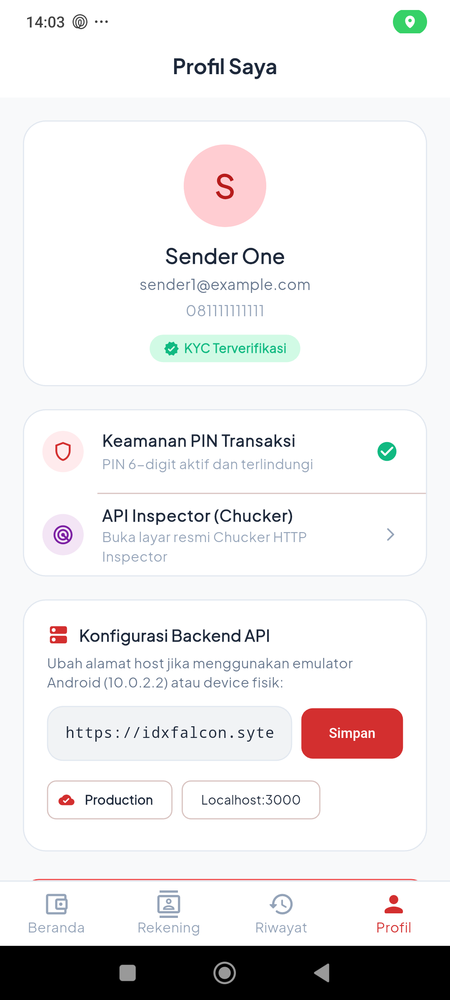
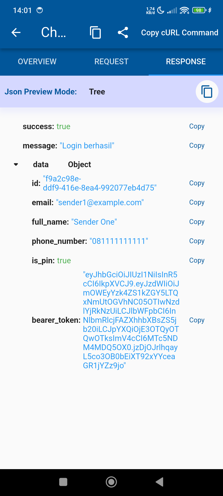

# 💳 DigiPay Mobile - Digital Wallet & Payment Platform

Aplikasi mobile dompet digital dan transfer antar-bank modern berbasis **Flutter** dengan pendekatan **Clean Architecture**, state management **BLoC**, routing deklaratif **GoRouter**, client HTTP **Dio**, anti-tampering request signing **HMAC-SHA256**, serta integrasi **Official Chucker HTTP Inspector**.

---

## 📸 Tampilan Aplikasi (Screenshots)

| 🏠 Beranda & Saldo | 💰 Top Up Saldo | ⭐ Daftar Rekening |
| :---: | :---: | :---: |
|  |  |  |
| *Dashboard Saldo IDR & Rekening Favorit* | *Topup Saldo dengan HMAC-SHA256 Signature* | *Manajemen Rekening Tersimpan & Favorit* |

| 📜 Riwayat Transaksi | 👤 Profil & KYC | 🕵️ Chucker HTTP Inspector |
| :---: | :---: | :---: |
|  |  |  |
| *Filter Mutasi: Semua / Berhasil / Diproses / Gagal* | *Status KYC & Manajemen Keamanan PIN* | *Inspect Payload API, Status HTTP & cURL* |

---

## 🏛️ Arsitektur Aplikasi (Clean Architecture)

Aplikasi dibangun mengikuti prinsip **Uncle Bob's Clean Architecture** dengan pemisahan tanggung jawab (*Separation of Concerns*) yang ketat ke dalam 3 layer utama per modul fitur:

```
lib/
├── core/                                # Shared utility & infrastruktur global
│   ├── constants/                       # Endpoint API, AppColors (Tema Merah Modern)
│   ├── network/                         # ApiClient (Dio), AuthInterceptor, SignatureHelper, Chucker
│   ├── routes/                          # GoRouter, Auth Guards, RefreshStream
│   ├── storage/                         # SessionStorage (Token & User Profile)
│   ├── theme/                           # AppTheme (Plus Jakarta Sans, Scarlet/Crimson Red)
│   ├── utils/                           # CurrencyFormatter (IDR), DateFormatter (id_ID)
│   └── widgets/                         # Reusable UI (CustomButton, CustomTextField, PinKeypad)
│
├── features/                            # Modul Fitur Clean Architecture
│   ├── auth/                            # Login, Register, Setup PIN, Verifikasi PIN
│   ├── wallet/                          # Home Dashboard, Balance Inquiry, Topup Saldo
│   ├── beneficiary/                     # List Bank, Cek Validitas Rekening, Rekening Favorit
│   ├── transfer/                        # Form Transfer, Confirmation Sheet, Invoice/Receipt
│   ├── history/                         # Riwayat Mutasi Transaksi & Filter Status
│   ├── profile/                         # Profil KYC, Keamanan Akun, Switcher Host Backend
│   └── main_navigation/                 # Bottom Navigation Bar (4 Tab)
└── main.dart                            # Entry point aplikasi
```

### 🧱 3-Layer Structure per Fitur:
1. **Domain Layer (Pure Dart, Zero Dependency):**
   - **Entities:** Representasi bisnis murni (`UserEntity`, `WalletEntity`, `TransferEntity`, `BeneficiaryEntity`).
   - **Repositories (Interface):** Kontrak abstraksi operasi data.
2. **Data Layer:**
   - **Models:** Serialisasi JSON request & response API.
   - **Data Sources:** HTTP client via `Dio` langsung ke server production.
   - **Repository Implementation:** Mengimplementasikan kontrak domain layer.
3. **Presentation Layer:**
   - **BLoC / Cubit:** Mengelola transisi state (`Event -> Bloc -> State`).
   - **Pages & Widgets:** Komponen UI responsif yang merefleksikan state BLoC.

---

## ✨ Fitur-Fitur Utama

### 1. 🔐 Autentikasi & Keamanan Berlapis
- **Login & Registrasi:** Otentikasi JWT Bearer token dengan validasi form lengkap.
- **PIN Transaksi 6-Digit (Layer 2 Security):** Keamanan transaksi menggunakan otorisasi PIN sebelum transfer dana.
- **Guard Routing:** `GoRouter` otomatis mengarahkan pengguna ke Setup PIN jika akun belum memiliki PIN, atau ke halaman login jika token habis.

### 2. 💳 Manajemen Dompet & Saldo (Wallet)
- **Live Balance:** Saldo realtime rupiah (`Available Balance` & `Amount on Hold`).
- **Isi Saldo (Top-Up):** Menambah saldo dengan pilihan nominal instan (Rp 50.000 s/d Rp 1.000.000) atau nominal kustom.
- **HMAC-SHA256 Anti-Tampering:** Setiap transaksi topup diverifikasi menggunakan `X-Signature` dan `X-Timestamp` untuk mencegah replay attack & tampering data.

### 3. 🏦 Inquiry & Manajemen Rekening (Beneficiary)
- **List Bank Partner:** Daftar bank resmi (BCA, Mandiri, BNI, BRI, CIMB, Permata).
- **Cek Rekening (Account Validation):** Cek nama pemilik rekening bank tujuan secara otomatis sebelum menyimpan.
- **Simpan Rekening & Favorit:** Simpan rekening tujuan transfer dan tandai sebagai favorit untuk transfer cepat di halaman beranda.

### 4. 💸 Transfer Antar Bank & Bukti Transaksi
- **Transfer Input:** Validasi saldo cukup, biaya admin otomatis (Rp 6.500 flat), dan input berita transfer opsional.
- **Idempotency Guard:** Header `Idempotency-Key` (UUID v4) untuk mencegah duplikasi debet saldo pada jaringan tidak stabil.
- **Live Transfer Invoice (Receipt):**
  - Tampilan status real-time (`SUCCESS`, `PROCESSING`, atau `FAILED`).
  - **Tombol "Perbarui Status Transaksi":** Memungkinkan pengguna memperbarui status mutasi secara instan dari status antrean ke status berhasil.
  - **Auto-Polling:** Secara otomatis memantau penyelesaian mutasi dalam beberapa detik tanpa harus meninggalkan halaman.

### 5. 📜 Riwayat Mutasi & Filter Transaksi
- Riwayat lengkap pencairan dana dan transfer.
- Filter tab cepat: **Semua**, **Berhasil**, **Diproses**, dan **Gagal**.
- Bottom sheet detail transaksi lengkap dengan tombol salin nomor referensi.

### 6. 🕵️ Official Chucker HTTP Inspector
- Integrasi resmi pustaka [`chucker_flutter`](https://github.com/ChuckerTeam/chucker).
- Floating Action Button (FAB) & menu pada profil untuk membuka dashboard Chucker kapan saja.
- Menampilkan detail request body, response headers, response tree JSON, status code, durasi, dan fungsi **Copy cURL Command**.

### 7. 🌐 Strictly Online Architecture
- Aplikasi beroperasi secara murni online terhadap backend production.
- Tidak menggunakan silent mock/dummy fallback, sehingga semua pesan error (misal: "Saldo tidak mencukupi", "PIN tidak valid", atau "Koneksi internet bermasalah") ditampilkan secara akurat dari backend.

---

## 🛠️ Spesifikasi Teknologi

| Komponen | Pustaka / Teknologi |
| :--- | :--- |
| **Framework** | Flutter (SDK ^3.10.0 / 3.47.0+) |
| **Bahasa** | Dart 3.x |
| **State Management** | `flutter_bloc: ^8.1.6`, `bloc: ^8.1.4` |
| **Routing** | `go_router: ^14.8.1` |
| **HTTP Client** | `dio: ^5.8.0+1` |
| **HTTP Inspector** | `chucker_flutter: ^1.9.2` |
| **Kriptografi & UUID**| `crypto: ^3.0.8`, `uuid: ^4.5.3` |
| **Penyimpanan Lokal** | `shared_preferences: ^2.5.4`, `flutter_secure_storage: ^9.2.4` |
| **Tipografi** | `google_fonts: ^6.2.1` (Plus Jakarta Sans) |
| **Format Uang & Tanggal** | `intl: ^0.20.2` (Locale: `id_ID`) |

---

## 🚀 Panduan Instalasi & Menjalankan Aplikasi

### 1. Prasyarat Sistem
- **Flutter SDK**: Versi `>= 3.10.0` (disarankan Flutter 3.27.x / 3.47.x).
- **Android SDK**: Android API level 21 s/d 34 (Android 14).
- **Java**: Java JDK 17 (Zulu / OpenJDK 17).
- Perangkat Android fisik atau Android Emulator dengan Developer Options & USB Debugging aktif.

### 2. Kloning & Pemasangan Dependensi
Buka terminal dan arahkan ke folder proyek:
```bash
cd /Users/anggamaulana/Documents/MY-PROJECT/Digi-Pay/digipay

# Unduh semua packages
flutter pub get
```

### 3. Menjalankan Aplikasi di Perangkat
Pastikan perangkat terdeteksi dengan perintah:
```bash
flutter devices
```

Jalankan aplikasi dalam mode debug:
```bash
# Menjalankan di perangkat fisik terhubung
flutter run -d <DEVICE_ID>

# Contoh:
flutter run -d 47f5258
```

### 4. Build APK Android
Untuk membuat file APK siap instal:
```bash
# Build Debug APK
flutter build apk --debug

# Lokasi APK hasil build:
# build/app/outputs/flutter-apk/app-debug.apk

# Install langsung ke perangkat via ADB:
adb install -r -d -t -g build/app/outputs/flutter-apk/app-debug.apk
```

---

## 🧪 Pengujian Otomatis (Automated Testing)

Aplikasi dilengkapi dengan pengujian menyeluruh: Unit test, Widget test, dan Live API Integration Suite:

```bash
# Menjalankan seluruh pengujian:
flutter test test/widget_test.dart test/widget_auth_test.dart test/qa_api_suite.dart
```

Hasil pengujian otomatis:
- ✅ Format mata uang IDR & tema warna merah.
- ✅ Render halaman Login & Validasi input email pengguna.
- ✅ Keypad interaktif Setup PIN (angka 1-9, 0, delete).
- ✅ Live Production API Health Check & Bank List Inquiry.
- ✅ Live User Authentication & JWT Bearer token generation.
- ✅ Live Wallet Balance query.
- ✅ Live PIN verification (Layer 2 Security).
- ✅ Live Beneficiary checking & saving.
- ✅ Live Transfer execution dengan Idempotency Key.

---

## 🌐 Konfigurasi Backend Production

- **Base URL Server:** `https://idxfalcon.sytes.net/digipay`
- **Swagger API Documentation:** `https://idxfalcon.sytes.net/digipay/api-docs/`
- **Anti-Tampering Signature Key:** `super-secret-transaction-key-2026`
- **Akun Utama Pengguna:** `angga.maulana@gmail.com`
- **Akun Alternatif Demo:** `sender1@example.com` / `Password123!` (PIN: `123456`)

---

## 👨‍💻 Kontributor
- **Author:** Angga Maulana
- **Platform:** DigiPay E-Wallet & Digital Banking System
